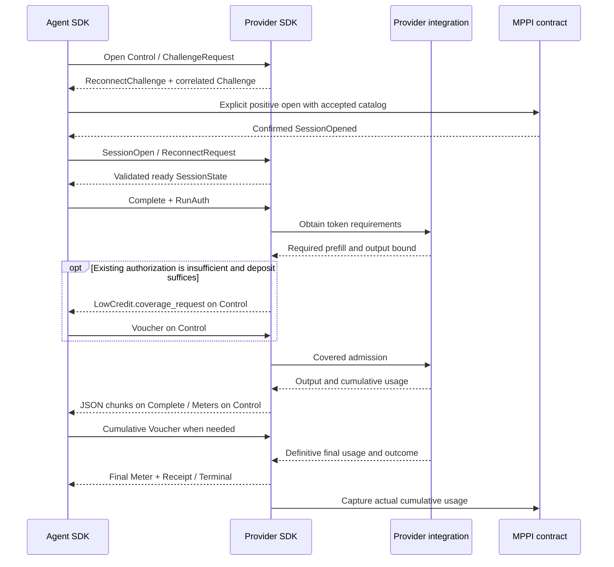

# MPPI v1 protocol profile

This profile accompanies the canonical [protobuf schema](../proto/mppi/v1/mppi.proto).
The schema fixes names, tags, types, presence and RPC shapes; this document fixes
validation and meaning. SDK payment checks require both. The
[Python runtimes](python-runtime.md) implement the paid request loop; the SDK
integration still requires the provider's execution and state bindings.

MPPI provides payment messages, signatures, arithmetic and session validation.
The provider supplies token requirements, cumulative usage and definitive
outcomes. The provider integrates its serving system and owns token measurement,
job execution, cancellation, storage, coordination and recovery.

This version settles in the six-decimal USDC ERC-20 interface on Arc. A selected
network profile pins the canonical MPPI proxy, token and ERC-8004 registry;
construction and a transaction hash alone do not verify a deployment.

## Transport

One public TLS origin exposes native gRPC with binary protobuf:

| Method | Shape | Contents |
| --- | --- | --- |
| `/mppi.v1.Chat/Completions` | Server streaming | Typed request envelope, JSON inference data, final accounting |
| `/mppi.v1.Control/Session` | Bidirectional streaming | Setup, attachment, vouchers, meters, funding guidance, close |

The client uses one connection and separate HTTP/2 streams for Control and each
Complete. A channel object alone does not prove a connection count. HTTP/2
connection resources are shared; independent Control processing and bounded
queues are required. A stalled consumer does not pause provider execution.
Control contains neither prompts nor inference output. Complete contains no
funding challenge, voucher or payment receipt. Inference is never automatically
replayed after connection failure.

The public HTTPS origin and TLS routing belong to the provider. MPPI adds no
`/v1` HTTP inference compatibility surface in this version. Responses support
does not yet have a v1 RPC. Native gRPC paths follow the
[gRPC HTTP/2 specification](https://github.com/grpc/grpc/blob/master/doc/PROTOCOL-HTTP2.md).
gRPC guarantees message order within an individual RPC, not between the two
RPCs. [gRPC lifecycle](https://grpc.io/docs/what-is-grpc/core-concepts/)

## Scalar and record validation

Every singular scalar, string and byte field uses explicit presence. `optional`
is a protobuf encoding choice, not permission to omit a semantically required
value. Unless listed below, every singular field in a populated message is
required. Empty repeated fields are permitted only when the message semantics
allow no rows. A oneof must select one known variant. Unknown ordinary protobuf
fields are tolerated; unknown enum values are rejected. All enums except
`PauseLevel` reject their zero `UNSPECIFIED` sentinel. `PauseLevel.NONE = 0` is a
valid present value.

| Truly optional fields | Rule |
| --- | --- |
| `SessionOpen.agent_id` | Absent is distinct from present uint256 zero |
| `ReconnectRequest.latest_voucher`, `SessionState.accepted_voucher` | Absence cannot erase previously accepted authorization |
| `SessionState.current_rate_card_hash` | Absent when no valid current offering is available |
| `TopUpNotice.model`, `rate_card_hash`, `tokens` | All present or all absent; present only for the actual caller token-derived amount |
| `LowCredit.remaining_tokens`, `suggest_top_up_tokens` | Both present when greatest applicable rate is positive; both absent when zero |
| `LowCredit.coverage_request` | Present for a correlated pending-request coverage target |
| `Drain.run_id` | Absent scopes drain to the whole session |
| `Terminal.settlement_reference`, `Receipt.settlement_reference` | Present only with actual confirmed event evidence |
| `RunState.rate_card_hash`, `control_generation`, `auth_signature` | All absent for `NOT_ADMITTED`; all required for admitted outcomes |
| `UpstreamError.http_status` | Present only with an upstream HTTP error status in 400..599 |
| `PaymentError` fields after `code` | Only applicable diagnostics; additional requirements below |

- Session/run/request ids, salts, nonces, hashes and transaction hashes are
  exactly 32 bytes. Addresses are exactly 20 bytes. ERC-8004 ids are uint256
  encoded as exactly 32 unsigned big-endian bytes, including leading zeros.
- Nonempty models use the catalog's exact identifier grammar below, except the
  explicitly empty `RunState.model` for `NOT_ADMITTED`.
- Monetary amounts and counts are uint64. Reject booleans, negatives, fractions
  and out-of-range SDK inputs before encoding. Never wrap or truncate.
- Generations start at 1. Meter sequences start at 1 and increase across the
  session, including reconnect. Snapshot/cursor zero means no prior meter.
  Overflow cannot reset either counter.
- MPPI signatures use exactly 65 bytes `r[32] || s[32] || v[1]`, low-s and v
  27/28, with successful nonzero ECDSA recovery to the fixed session signer.
  An adapter may normalize v from 0/1 before producing this wire form.
- Reject duplicate logical keys in catalogs, price-group totals, coverage rows,
  run states and pending run ids. Required collections cannot be truncated.
- Coverage rows are nonempty and include the candidate model/hash even at zero
  cost. A SessionState includes its initial catalog and every referenced
  historical/current version, including zero-priced accepted groups.
- Generated protobuf parsing retains its standard repeated-tag, merge and
  last-value behavior. Validate the decoded message. Sign EIP-712 values,
  never serialized protobuf bytes.

Explicit presence and parsing behavior follow the
[protobuf presence guide](https://protobuf.dev/programming-guides/field_presence/).
Signature validation follows
[OpenZeppelin ECDSA v5.7.0](https://github.com/OpenZeppelin/openzeppelin-contracts/blob/v5.7.0/contracts/utils/cryptography/ECDSA.sol).
`SessionStatus` requires an explicit contract mapping: wire Open/Closing/Closed
is 1/2/3; the contract enum is 0/1/2. Check positive cumulative deposit before
interpreting a contract status, because a nonexistent record is zero-filled.

## JSON inference payload

`CompleteRequest.payload`, `ChatChunk.payload` and `UpstreamError.body` contain
one UTF-8 JSON object. Reject malformed UTF-8, BOM, invalid JSON, duplicate
member names after escape decoding, malformed Unicode, and values outside JSON
(including NaN/Infinity). Preserve original bytes, unknown fields and numeric
text after a bounded validation pass. Do not canonicalize inference JSON.

The request payload's `model` string must exactly equal the envelope and signed
RunAuth model. Payload omission of `stream` means false; a present value must be
a JSON boolean and agree with the explicitly present envelope value. Never
rewrite the caller's flag.

- With `stream=true`, carry each provider JSON chunk once, including empty
  choices and usage-only chunks. The provider's integration consumes upstream
  SSE framing and `[DONE]`; neither is a payload. MPPI does not assemble tool
  calls or reinterpret finish reasons.
- With `stream=false`, carry the provider's complete JSON response as one
  payload, followed by the definitive Terminal. Do not synthesize it by
  collecting streamed deltas.
- Inference error JSON travels in `upstream_error`; its optional HTTP status
  preserves a corresponding upstream error response. It never becomes payment
  metadata. An invalid non-JSON upstream response remains a local failure.

`google.protobuf.Struct` is deliberately absent: its numeric value is a double,
which cannot preserve an integer such as `9007199254740993`. The JSON bytes must
preserve it. [Protobuf Value](https://protobuf.dev/reference/protobuf/google.protobuf/#value),
[JSON interoperability](https://www.rfc-editor.org/rfc/rfc8259.html#section-6)

## Catalogs and pricing

The catalog is a nonempty JSON array. Each row has only required `model`,
`input`, `output` and optional `cache`. Rates are decimal **strings** in
six-decimal USDC base units per million tokens. Each matches ASCII
`0|[1-9][0-9]*` and fits uint64. Reject numeric JSON rates, signs, exponent
notation, whitespace, leading zeros, nulls, duplicate/unknown/missing keys and
duplicate models. Cache absence and explicit `"0"` remain distinct.

Models contain exactly one slash separating namespace and repository. Each
component uses ASCII letters, digits, underscore, hyphen and dot, starting and
ending with a letter, digit or underscore. Reject `--`, `..` and a `.git`
suffix. The repository component is 1..96 characters. Preserve exact spelling
and case; syntax does not prove model availability.

Sort rows strictly by model UTF-8 bytes and encode with JCS, with no BOM,
inter-token whitespace or trailing newline. For this schema, object keys are
`cache,input,model,output` when cache exists and `input,model,output` otherwise.
Validate received bytes against the canonical serialization byte for byte;
never repair historical bytes into an accepted version. `rate_card_hash` is
Keccak-256 of the original canonical bytes. Catalog evidence and original
RunAuth bind each admitted run to its accepted version for all renewals and
final usage. New runs use current confirmed prices in the same funded session.
[JCS](https://www.rfc-editor.org/rfc/rfc8785.html#section-3.2)

Let `Q = 1_000_000`, D be cumulative deposit, A the accepted voucher ceiling,
N the exact cumulative usage numerator and R all remaining admitted reservation
numerators. For counts `(I,C,O)` at accepted rates `(ri,rc,ro)`:

```text
n = (I - C) * ri + C * rc + O * ro
U = floor(sum(n) / Q)
required = ceil((N + R + candidate_numerator) / Q)
admission requires required <= A <= D
```

Require `C <= I`; positive cache counts need an accepted cache price. With
absent cache and C=0, compute `I*ri + O*ro`. Counts are cumulative per run;
duplicates add nothing. Validate nondecreasing counts and nondecreasing exact
cost; a retrospective cache classification cannot lower recognized usage.
Use checked intermediates of at least 256 bits or arbitrary precision and check
the final amount before narrowing to uint64. Ceiling uses quotient/remainder,
not an unchecked `numerator + Q - 1`.

Consuming covered work increases N by the exact cost delta and decreases that
run's remaining reservation by the same delta as one payment-state result.
Do not double count it. A report exceeding its remaining covered bound is an
inconsistency, not permission to manufacture credit. Retain evidence and prevent
new grants. Definitive final usage releases only unused reservation. Settlement
changes S (confirmed capture), never N/A/D. A restored usage total below S is
inconsistent; it must not create headroom.

Scalar funding-token guidance uses `P = max(ri, ro, present rc)` and
`ceil(tokens*P/Q)`, with a caller-selected positive token count and a resulting
positive uint64 amount. Reject zero-derived funding; do not invent a minimum.
The ordinary output buffer is 1,000 actual output tokens; suggested funding is
1,000,000 conservative token equivalents. A top-up adds USDC and changes no
price binding. Raw top-up amounts are positive integer six-decimal USDC units.
Guidance never authorizes an automatic deposit.

For positive P, remaining-token guidance is
`min(MAX_UINT64, max(0, D*Q-N-R) div P)`. This saturation is advisory; monetary
amounts are never clamped. At P=0 both scalar LowCredit fields are absent.
An existing positively funded session can run zero-priced work, with a valid
accepted zero voucher if no voucher has yet been accepted.

## Identity and signed authority

`SessionDescriptor` is `(agent, sessionSigner, providerId, recipient, operator,
token, salt)`. The funding wallet executes opening and thereby authorizes its
nonzero immutable ECDSA session signer. Compute the id as Keccak-256 of Solidity
`abi.encode` of those seven fields, canonical MPPI proxy address and chain id
in that order. Protobuf encoding is never an input to this computation.

The four EIP-712 type strings remain:

```text
Voucher(bytes32 sessionId,uint64 cumulativeAmount)
RunAuth(bytes32 sessionId,uint64 controlGeneration,bytes32 runId,string model,bytes32 rateCardHash)
ReconnectAuth(bytes32 sessionId,bytes32 nonce)
CloseAuth(bytes32 sessionId)
```

The MPPI domain is `name="MPPI"`, `version="1"`, the selected chain id and the
canonical proxy as `verifyingContract`. Verify every proof against the confirmed
descriptor's session signer. A voucher cannot accept a model price; RunAuth
does. RunAuth does not sign the prompt or a monetary amount. Funding wallet
authorization and ERC-8004 identity remain distinct from the session credential.
No generic ERC-1271 validation is added to these deferred MPPI proofs.
[EIP-712 encoding](https://eips.ethereum.org/EIPS/eip-712#definition-of-encodedata)

## Control directions and attachment

Agent messages are `ChallengeRequest`, `SessionOpen`, `ReconnectRequest`,
`Voucher`, `TopUpNotice`, `CloseRequest`. Provider messages are `Challenge`,
`ReconnectChallenge`, `SessionState`, `Meter`, `LowCredit`, `Drain`, `Receipt`,
`CloseResult`. A wrong direction/session ends the offending Control RPC.

On stream opening the provider issues a random one-use ReconnectChallenge.
Unpaid ChallengeRequest/Challenge is correlated by request id and model on that
stream; repeated guidance preserves its original hash. The agent validates the
provider, chain, contract and exact current catalog before choosing positive
funding. A malformed ChallengeRequest model ends the setup Control RPC with
native INVALID_ARGUMENT. A syntactically valid model absent or unavailable for
funding guidance ends that setup RPC with native NOT_FOUND and a concise message,
without a Challenge, PaymentError, OpenAI error body, engine call or funding.
This setup result is distinct from SESSION_NOT_FOUND. Actual inference errors
remain on Complete. [Native gRPC status definitions](https://grpc.github.io/grpc/core/md_doc_statuscodes.html)

SessionOpen names a transaction; the provider confirms the canonical opening
event, full descriptor and state. The notice grants no attachment. A provider
keeps a closed session for a bounded window. For a session closed on chain that
it no longer holds, it refuses SessionOpen with `SESSION_CLOSED`: the session is
terminal, and no reattachment follows. When its
optional agent_id is present, verify the selected registry's getAgentWallet(id)
returns the descriptor's funding-wallet agent, not its session signer.
[ERC-8004 wallet metadata](https://eips.ethereum.org/EIPS/eip-8004#on-chain-metadata)

ReconnectRequest signs that stream's nonce with the confirmed session signer.
Only successful proof may replace an attachment and increment its generation.
Repetition of the accepted request on the same stream may return the same result,
never another generation. All subsequent mutating messages must come from the
actual owning stream while its generation is current. Socket equality, forwarded
headers and knowing a session id do not establish ownership.

Control closure, cancellation or client write-side EOF makes the attachment
unready. Stop new grants; the provider terminates affected jobs and supplies
their final counts before unused reservations can be released. Complete's
ordinary request-body end is not a Control half-close. Replacement connection
requires authenticated recovery; backend routing changes alone do not.

Recovery validates descriptor/opening evidence, accepted voucher, exact catalog
versions, original price-acceptance signatures and cumulative counts. `PricedUsage`
contains one row per used model/hash with representative original RunAuth.
`RunState` supplies requested pending runs and runs terminated during recovery;
its admitted entries retain their original generation/signature. `NOT_ADMITTED`
has a present empty model, absent binding proof and present zero counts, and
requires consistent admission history. Missing history is never that outcome.

Replace the checkpoint through `meter_seq`, do not add snapshot totals to old
totals. RunState counts are already in price totals. Ignore delayed meters at
or below that cursor; reject rollback below the retained cursor. Preserve close
intent. Missing/contradictory accounting or unresolved termination prevents
readiness. A ready snapshot still needs fresh chain/pause/deadline validation;
no inference resumes and no replacement funded session opens automatically.

## Admission and voucher renewal

1. After confirmed funding and a ready authenticated attachment, the agent
   submits one signed Complete with a fresh session-unique run id. The provider
   supplies the prepared prefill and output bound before paid execution.
2. With sufficient accepted A and no earlier request of the session within its
   turn (step 4), the gate checks the current attachment, prices, fresh
   chain/pause/deadline state and aggregate coverage. It records the
   immutable run binding and reservation before authorizing dispatch once.
3. When D suffices but A is absent/short, send `LowCredit.coverage_request` and
   wait on this unadmitted Complete. There is no execution reservation or usage
   yet. Rows are the full session target (usage + all admitted remaining bounds
   + this candidate), unique by model/hash. Agent sums and prices once, using
   only accepted historical prices and this request's signed prices.
4. Normal Control Voucher acceptance can release that gate. The fixed positive
   configured `payment.authorization_wait_ms` starts at the first prepared
   D-sufficient/A-short check, uses monotonic time and never resets. Earlier RPC
   deadline/cancel wins. Recheck all current state before dispatch; two waiting
   calls cannot reuse the same headroom. Waiting calls are admitted in the order
   they first waited, each for a turn of 2 s, or half the authorization wait if
   shorter. While an earlier call is within its turn, a later covered one waits
   too, without sending guidance; otherwise each later admission would raise a
   waiting call's target again. A call the agent never covers delays covered
   ones by at most a turn and never fails them. The earliest uncovered call
   repeats its guidance after a voucher that leaves it short, and once a turn.
   Order holds while the agent's voucher round trip is shorter than a turn; a
   call whose voucher takes longer may be overtaken once its turn ends.
5. Wait expiry is request-scoped `SESSION_NOT_READY/AUTHORIZATION_REQUIRED`.
   If D is short, enqueue the correlated LowCredit and fail Complete with
   `INSUFFICIENT_DEPOSIT`. Delivery may occur in either order; the failed request
   never revives. Once failure/cancel is known locally, late guidance cannot
   trigger a new voucher for that request. A valid voucher already in flight
   remains session-wide authorization, never usage.

Validate signatures, stream ownership, session binding and deposit bound before
accepting vouchers. The first valid voucher may be zero. Greater amounts raise
A; valid equal/lower vouchers are no-ops preserving the high-water ceiling.
There is no voucher ACK. A voucher cannot restore readiness or bypass closure,
pause or expiry. A changed admission catalog produces `PRICE_CHANGED`; the
caller must accept new terms before a fresh request.

After admission, provider-reported cumulative Meters and the admitted rates drive
ordinary asynchronous renewal. Send a meter at least every 1,000 output tokens,
earlier when needed to retain coverage, and at final accounting. An admitted job
that lacks renewed funding is terminated within its existing covered bound.
There is no active-job authorization wait or pause/resume state.

## Definitive outcomes and settlement

One definitive provider report establishes final counts and COMPLETED, FAILED
or CANCELLED. Validate and account once, assign the final Meter sequence, then
enqueue Receipt on Control and Terminal on Complete when writable. Neither
delivery ordering nor delivery itself is guaranteed across the two streams.
Both records must agree on session/run/model/hash, counts, status, amount and
final sequence. Repeats do not add usage; conflicts fail validation.

Terminal/Receipt never use NOT_ADMITTED. A cancellation request alone cannot
prove termination. Unknown outcomes retain pending run ids and reservations.
The agent ends an iterator successfully only after a valid COMPLETED Terminal
and gRPC OK trailers. Missing final delivery remains uncertain until recovery;
recovery does not recreate missing inference output.

`amount = floor(run_numerator/Q)` is informational and non-additive. Actual
billing is `floor(session_numerator/Q)`. Receipt's `settled_cumulative` and
required `chain_observation` describe a session-wide confirmed observation.
An optional settlement reference must identify the canonical Settled event for
that transaction/session with positive delta. A silent no-op has no reference;
a later capture cannot be attributed to an earlier transaction. No final record
waits for a new settlement transaction merely to provide a reference.

An admitted upstream failure with definitive final usage carries UpstreamError,
then FAILED Terminal and gRPC OK: the transport carried an application error.
The SDK raises that upstream error while retaining the payment result. Without
final usage, preserve the upstream error, end with the applicable non-OK status
and keep accounting unresolved. A pre-admission upstream validation/capacity
failure can carry its error followed by non-OK status, without a Terminal.

Eligible periodic capture uses `max(U,S)` within voucher/deposit/deadline bounds
and keeps the session open. Cooperative CloseAuth stops new grants, accounts
final work, then closes and refunds. After collection expiry only refund-only
close at S is permitted. CloseResult requires confirmed canonical closing
event/state. A pending, unknown or reverted transaction is not CloseResult.
Repeated close intents continue the same operation; timeout does not clear intent.

The contract enforces the signed monetary ceiling and its eligibility rules;
it cannot prove provider counts or actual usage. This remains the v1 trust limit.

## Errors

For MPPI payment errors, `grpc-status-details-bin` contains serialized
`google.rpc.Status` with exactly one `Any` whose type URL is
`type.googleapis.com/mppi.v1.PaymentError`. Its code equals the gRPC status.
Keep prompt data, signatures and arbitrary upstream JSON out of trailers.

| PaymentError code | gRPC status |
| --- | --- |
| `INSUFFICIENT_DEPOSIT` | `RESOURCE_EXHAUSTED` |
| `SESSION_NOT_FOUND` | `NOT_FOUND` |
| `VOUCHER_STALE` (reserved; no duplicate-voucher producer) | `FAILED_PRECONDITION` |
| `SESSION_NOT_READY` | `FAILED_PRECONDITION` |

Stable not-ready reasons are `PRICE_CHANGED`, `CONTRACT_PAUSED`, `CLAIM_DEADLINE`,
`CHAIN_STATE_STALE`, `SESSION_CLOSED`, `STATE_UNAVAILABLE`, `INCONSISTENT_STATE`,
`CONTROL_NOT_READY`, `CLOSE_PENDING`, `INCONSISTENT_USAGE`, `AUTHORIZATION_REQUIRED`.
For SESSION_NOT_READY, `reason` is required and must be a nonempty string.
Unknown reasons remain not-ready. PRICE_CHANGED requires requested/current
hashes; CONTRACT_PAUSED requires the present observed PAYMENTS or ALL level. Request-scoped
payment errors identify session and run. Run diagnostics require a session id.
Only fresh confirmed deposit=0 establishes SESSION_NOT_FOUND; missing provider
state and pending opening transactions do not.

Malformed input uses INVALID_ARGUMENT, invalid authentication UNAUTHENTICATED,
duplicate run ids ALREADY_EXISTS, local message/queue limits RESOURCE_EXHAUSTED;
transport cancellation/deadline/unavailability retain their native status.
Complete failures end that request, leaving healthy Control/unrelated runs.
Invalid Control ends that stream and invokes attachment-loss handling. Invalid
provider reports cannot advance accounting or release coverage. Invalid received
meters/finals preserve the last valid agent checkpoint and stop new signing.

The status carrier follows [google.rpc.Status](https://github.com/googleapis/googleapis/blob/master/google/rpc/status.proto).
Rich error size is bounded because metadata limits can discard an oversized
error. [gRPC error handling](https://grpc.io/docs/guides/error/)

## Resource profile

The common configurable SDK defaults are implementation bounds, not token
policies or measured performance claims:

| Resource | Default maximum |
| --- | --- |
| Decompressed protobuf message | 16 MiB |
| Ordinary Control message | 64 KiB |
| SessionState | 16 MiB |
| Exact catalog bytes | 1 MiB |
| JSON container nesting (root object/array counts as 1) | 128 |
| Reconnect pending run ids | 1,024 |
| Each application send/receive queue | 64 messages and 16 MiB |
| Serialized rich error Status | 2 KiB |

Check lengths before application decoding/allocation when available and enforce
decompressed message limits in transport settings. A single allowed message may
consume a queue's whole byte budget. Configured tighter bounds fail explicitly
and must be reported in deployment diagnostics; peers cannot infer them from a
new negotiation message. Queue-full paths need configured bounded waiting and
cancellation; payment processing cannot depend on user callbacks.

Before admitting work/history, ensure complete required coverage and recovery
messages remain representable. A 16-MiB snapshot ceiling does not permit a
64-KiB LowCredit to exceed its own ceiling. Reject with explicit resource or
not-ready failure; never truncate evidence or invent pagination. If rich error
encoding exceeds 2 KiB, use the concise native gRPC status/message without rich
details. These defaults require long-payload, decompression, queue and
cross-language integration measurements before a production performance claim.

## Flow summary



Message generation and pure fixtures validate this contract's encoding. The
[independent paid-loop fixture](../tests/paid_loop/README.md) exercises installed
Python SDKs, native TLS transport and local contract payments. Live network,
wallet-service and provider-engine acceptance are separate requirements.
